<div align="center">

# YesPlayMusic

**A good-looking desktop music player, with music sources provided by plugins**

macOS · Windows · Linux

[](https://github.com/qier222/YesPlayMusic/releases/latest)
[](https://github.com/qier222/YesPlayMusic/actions/workflows/ci.yml)
[](./LICENSE)

[简体中文](README.zh-CN.md) · English

[Download](#download) · [Features](#features) · [Screenshots](#screenshots) · [Installing plugins](#installing-plugins) · [Writing plugins](#writing-plugins) · [AI assistants (MCP)](#ai-assistants-mcp) · [Building from source](#building-from-source)

</div>

## What is this

YesPlayMusic 3.0 is a desktop music player rewritten from scratch in Flutter.

It **ships with no online music service**: it plays local music out of the box, and online catalogs, playlists, lyrics, comments and so on all come from third-party plugins. Plugins run in a sandbox built into the app, and each plugin's manifest must declare which websites it can access and whether it can launch programs on your computer.

## Download

Download the package for your system from [Releases](https://github.com/qier222/YesPlayMusic/releases/latest):

| System            | File                                          | Notes                                                                                      |
| ----------------- | --------------------------------------------- | ------------------------------------------------------------------------------------------ |
| macOS 12+         | `YesPlayMusic-<version>-macos.dmg`            | Apple Silicon (M-series chips) only                                                        |
| Windows 10/11 x64 | `-windows-x64-setup.exe` or `-portable.zip`   | The installer is not code-signed; if SmartScreen warns, click "More info → Run anyway"     |
| Linux x64         | `-linux-x64.tar.gz`                           | Requires libmpv: `sudo apt install libmpv2` (`libmpv1` on older distributions)             |

The macOS and Windows builds check for updates automatically; on Linux, new versions are shown in Settings → About.

## Features

- **A record-shelf library**: albums stand on a shelf like book spines, sorted by title or release date; songs are grouped by the month they were added, and artists are shown as bubbles.
- **3D Coverflow**: flip through albums, playlists, songs and artists by dragging, scrolling or using the arrow keys, and click to play.
- **Colors from cover art**: the album and Now Playing pages take their background from the cover's dominant color; choose from 6 accent colors (Lilac, Sky, Mint, Sun, Rose, Flame).
- **Now Playing**: lyrics with translations, the play queue, similar songs and song comments, all on one page.
- **Local music**: scans your music folders and reads tags, embedded cover art and `.lrc` lyrics; supports FLAC, MP3, M4A, WAV, AIFF, OGG, OPUS, APE and more.
- **Multiple music sources**: local music and each plugin are separate music sources; right-click the avatar in the bottom-left corner to switch at any time. Home, Explore, Search, albums, artists and playlists all come from the current source.
- **System integration**: Now Playing in the macOS Control Center and lock screen, media keys and headphone buttons; follows the system proxy.
- **Keyboard control**: common actions have shortcuts, which won't fire while you're typing.

### Screenshots

<table>
  <tr>
    <td colspan="2" align="center">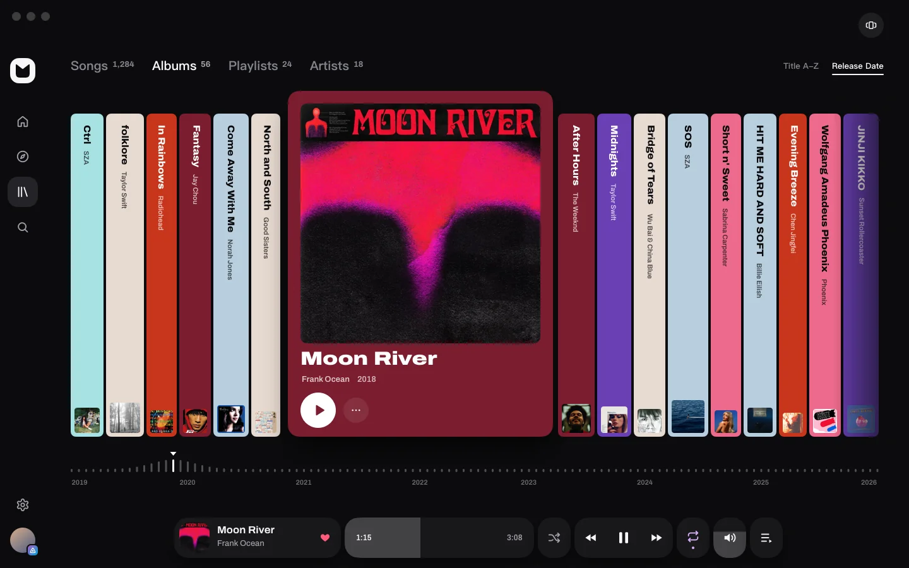<br /><sub>Library: albums on a record shelf, with a release-date timeline below</sub></td>
  </tr>
  <tr>
    <td width="50%" align="center">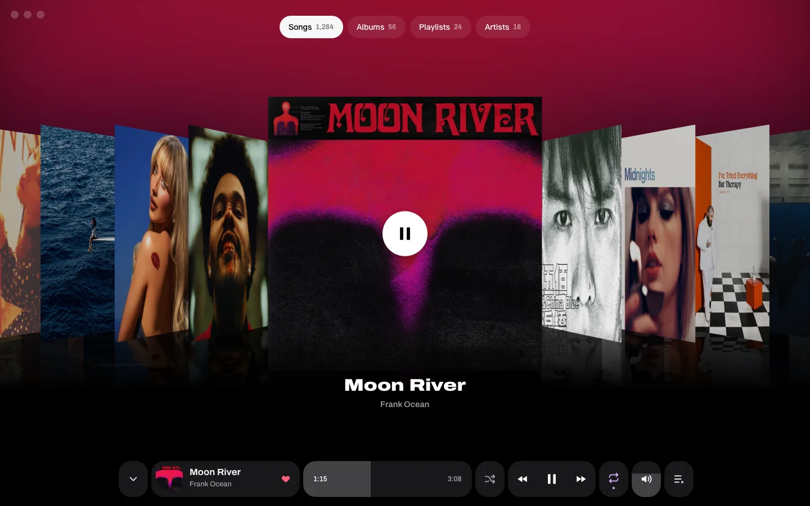<br /><sub>3D Coverflow</sub></td>
    <td width="50%" align="center">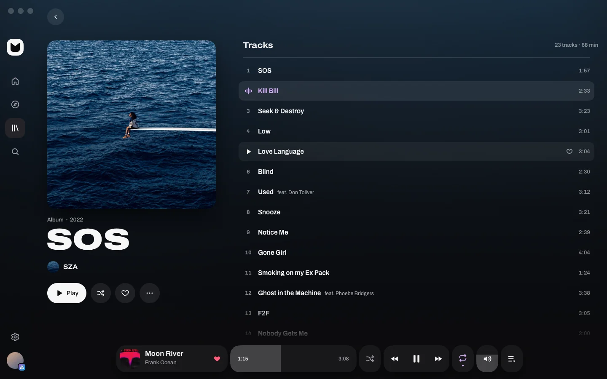<br /><sub>Album: background follows the cover's dominant color</sub></td>
  </tr>
  <tr>
    <td width="50%" align="center">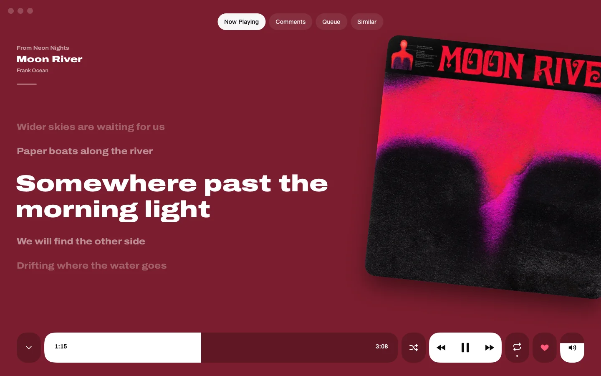<br /><sub>Now Playing: lyrics and translations</sub></td>
    <td width="50%" align="center">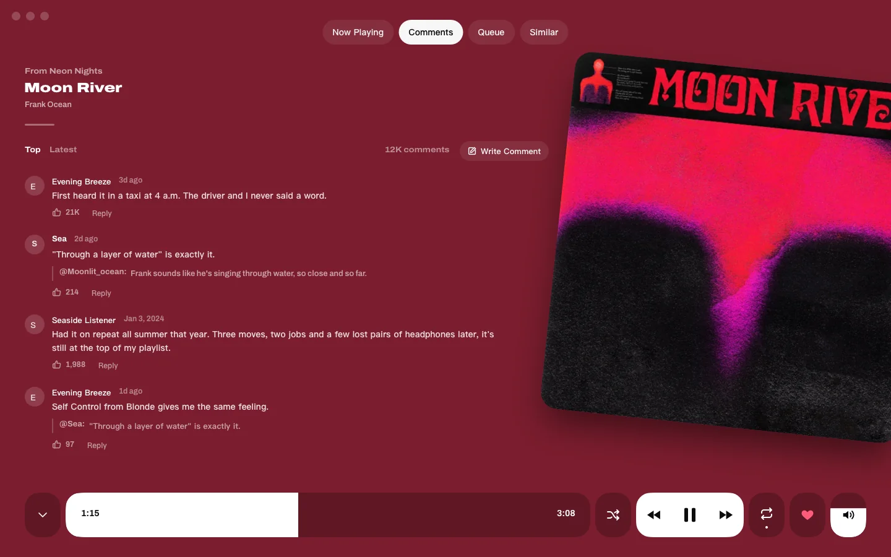<br /><sub>Now Playing: song comments</sub></td>
  </tr>
  <tr>
    <td width="50%" align="center">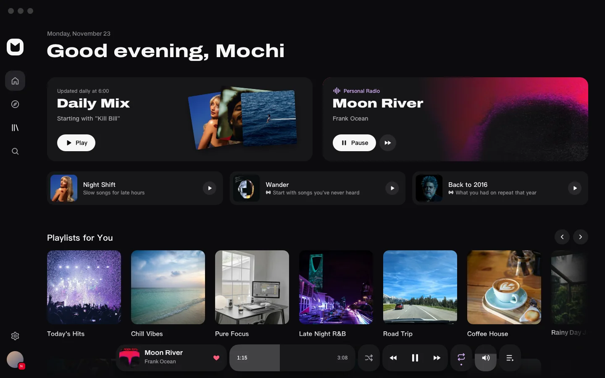<br /><sub>Home: provided by the current music source</sub></td>
    <td width="50%" align="center">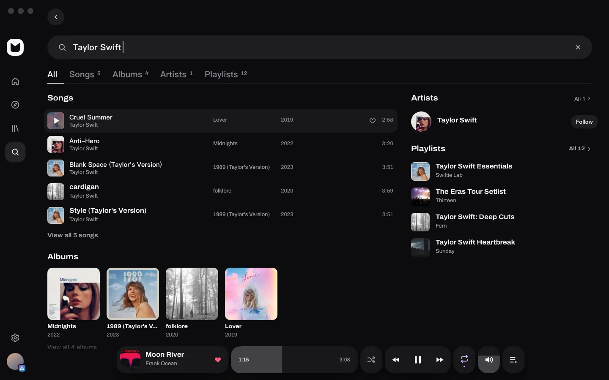<br /><sub>Search</sub></td>
  </tr>
  <tr>
    <td width="50%" align="center">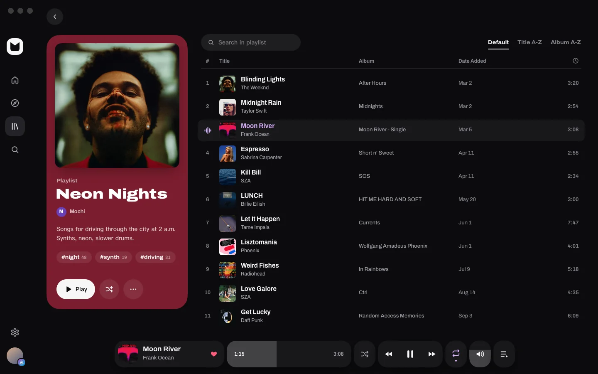<br /><sub>Playlist</sub></td>
    <td width="50%" align="center">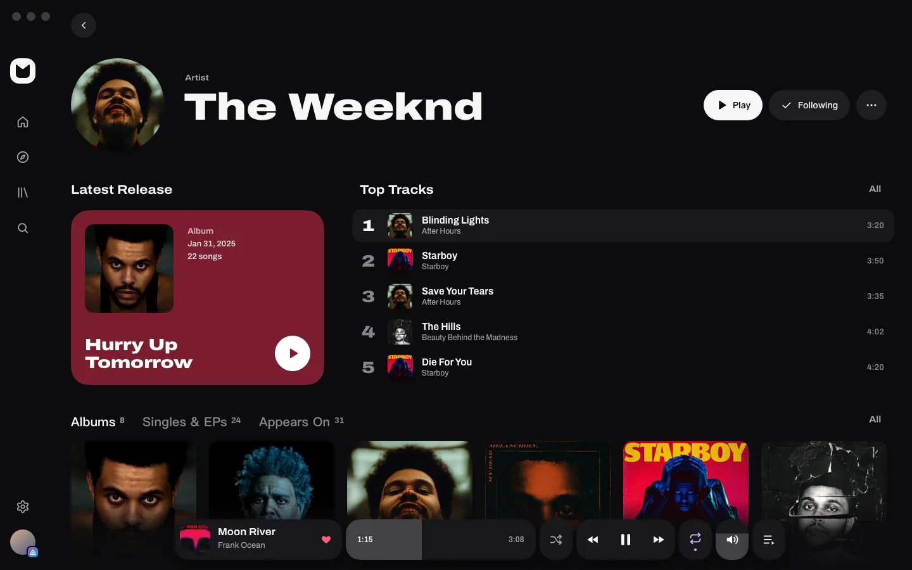<br /><sub>Artist</sub></td>
  </tr>
  <tr>
    <td width="50%" align="center">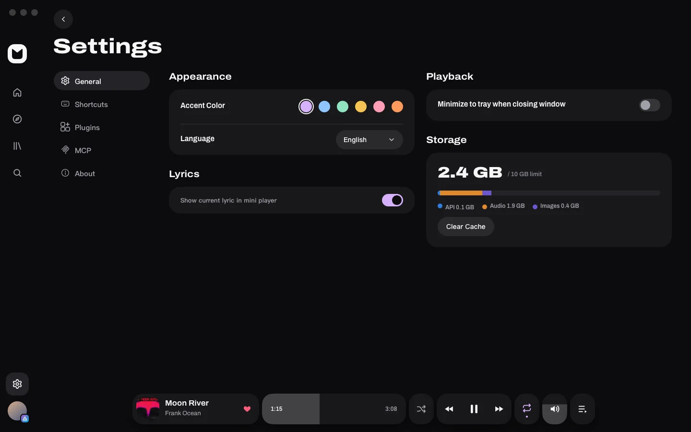<br /><sub>Settings: 6 accent colors</sub></td>
    <td width="50%" align="center">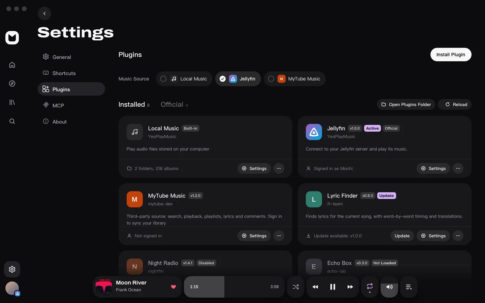<br /><sub>Settings: plugins</sub></td>
  </tr>
</table>

## Installing plugins

**Official plugins**

| Plugin   | For                                                                  |
| -------- | -------------------------------------------------------------------- |
| Emby     | Emby servers                                                         |
| Jellyfin | Jellyfin servers                                                     |
| Plex     | Plex servers                                                         |
| Subsonic | Navidrome, Gonic, Airsonic, Ampache and other Subsonic-compatible servers |

**Third-party plugins**: search GitHub for the [`yesplaymusic-plugin`](https://github.com/topics/yesplaymusic-plugin) topic. Please add this topic to your repository when you publish a plugin.

**How to install**: Settings → Plugins → Install Plugin. Official plugins install with one click; for third-party plugins, paste a GitHub repository, Release or .zip link, or install from a local folder. Once installed, right-click the avatar in the bottom-left corner to switch to the new music source.

**Security**: installing a plugin means running someone else's code on your computer, so only install plugins you trust. The restrictions the app places on plugins are described in [SECURITY.md](SECURITY.md); the main ones are:

- each plugin runs in its own QuickJS sandbox, cannot read or write files or start processes directly, and has memory and time limits;
- it can only access the websites declared in `permissions.network`;
- launching a program on your computer (such as `yt-dlp`) must be declared in the manifest and separately allowed by you in Settings.

## Writing plugins

A plugin is a `plugin.json` plus a JavaScript module; the app shows whatever features the exported functions provide.

Plugins lay out their own Home and Explore pages: the app has several built-in components (special-mode cards, horizontal card shelves, paged song grids, charts, card grids) that plugins can combine freely. If you need a different kind of component, please [open an issue](https://github.com/qier222/YesPlayMusic/issues/new/choose).

See the [plugin development guide](docs/plugins.md) (in Chinese) for the full API.

## AI assistants (MCP)

The app has a built-in MCP server that lets AI agents such as Claude and Cursor search for songs, play music, and manage the queue and playlists for you. Turn it on in Settings → MCP. By default it only listens on `127.0.0.1:18888`, and you can enable token authentication and read-only mode.

```json
{
  "mcpServers": {
    "yesplaymusic": { "url": "http://127.0.0.1:18888/mcp" }
  }
}
```

Clients that only support stdio can use the `bin/ypm_mcp_bridge.dart` bridge in this repository; the settings page can copy the configuration for you.

## Building from source

Requires Flutter 3.50 or later (Dart 3.14, which uses Build Hooks to compile the bundled QuickJS).

```sh
git clone https://github.com/qier222/YesPlayMusic.git
cd YesPlayMusic
flutter pub get
flutter run -d macos      # or windows / linux
flutter test
```

Additional requirements per platform:

- **macOS**: Xcode and CocoaPods
- **Windows**: Visual Studio 2022 with the "Desktop development with C++" workload
- **Linux**: `sudo apt install clang cmake ninja-build pkg-config libgtk-3-dev liblzma-dev libmpv-dev`

## Feedback

- Report problems and suggestions in [Issues](https://github.com/qier222/YesPlayMusic/issues/new/choose).
- Report security issues privately; see [SECURITY.md](SECURITY.md).

## License

[GPL-3.0](LICENSE). Third-party components and their licenses are listed in [THIRD_PARTY_NOTICES.md](THIRD_PARTY_NOTICES.md); see [CHANGELOG.md](CHANGELOG.md) for version history.
