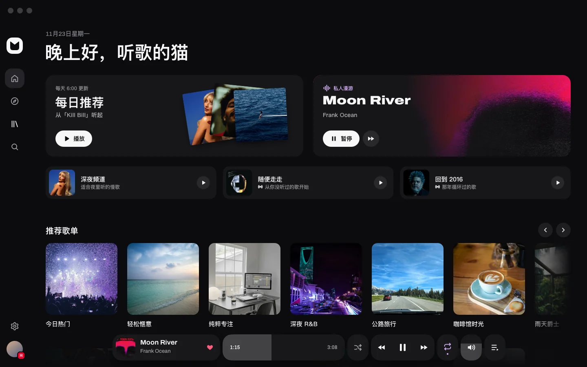
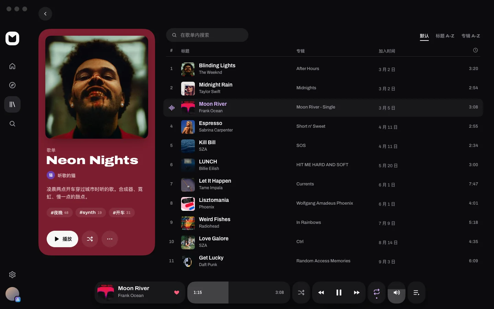
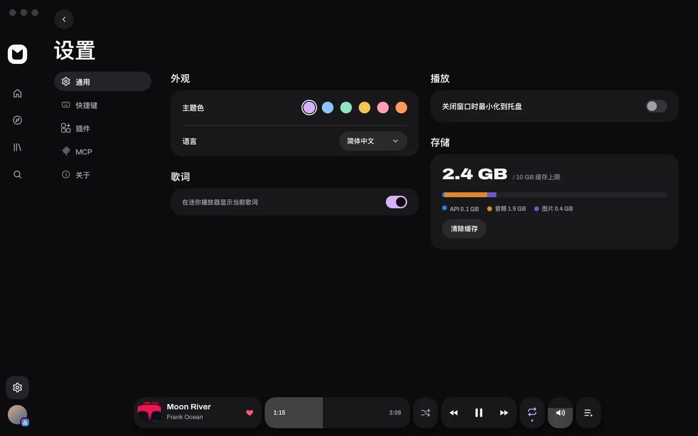

<div align="center">

# YesPlayMusic

**高颜值的桌面音乐播放器，音乐源由插件提供**

macOS · Windows · Linux

[](https://github.com/qier222/YesPlayMusic/releases/latest)
[](https://github.com/qier222/YesPlayMusic/actions/workflows/ci.yml)
[](./LICENSE)

简体中文 · [English](README.md)

[下载](#下载) · [功能](#功能) · [截图](#截图) · [安装插件](#安装插件) · [开发插件](#开发插件) · [AI 助手（MCP）](#ai-助手mcp) · [从源码构建](#从源码构建)

</div>

## 这是什么

YesPlayMusic 3.0 是用 Flutter 从头重写的桌面音乐播放器。

它本身**不内置任何在线音乐服务**：开箱即可播放本地音乐，在线曲库、歌单、歌词、评论等都来自第三方插件。插件跑在应用内置的沙箱里，能访问哪些网站、能不能启动本机程序，都要在插件清单里声明。

## 下载

在 [Releases](https://github.com/qier222/YesPlayMusic/releases/latest) 页面下载对应系统的安装包：

| 系统              | 文件                                        | 说明                                                                        |
| ----------------- | ------------------------------------------- | --------------------------------------------------------------------------- |
| macOS 12+         | `YesPlayMusic-<版本>-macos.dmg`             | 只支持 Apple Silicon（M 系列芯片）                                          |
| Windows 10/11 x64 | `-windows-x64-setup.exe` 或 `-portable.zip` | 安装包没有代码签名，SmartScreen 提示时点「更多信息 → 仍要运行」             |
| Linux x64         | `-linux-x64.tar.gz`                         | 需要系统装有 libmpv：`sudo apt install libmpv2`（较旧的发行版是 `libmpv1`） |

macOS 和 Windows 版本会自动检查更新；Linux 版本在 设置 → 关于 里提示新版本。

## 功能

- **唱片架式的音乐库**：专辑像书脊一样排在架上，按标题或发行时间排列；歌曲按加入时间分月显示，艺人以气泡呈现。
- **3D Coverflow**：拖拽、滚轮或方向键翻阅专辑、歌单、歌曲和艺人，点一下就播放。
- **封面取色**：专辑页、正在播放页的背景跟随封面主色；6 种主题色可选（丁香紫、天蓝、薄荷、日光、玫瑰、橙焰）。
- **正在播放**：歌词和翻译、播放队列、相似歌曲、歌曲评论，同一页里切换。
- **本地音乐**：扫描本地音乐文件夹，读取标签、内嵌封面和 `.lrc` 歌词，支持 FLAC、MP3、M4A、WAV、AIFF、OGG、OPUS、APE 等格式。
- **多个音乐源**：本地音乐和每个插件都是一个音乐源，右键左下角头像随时切换；首页、发现、搜索、专辑、歌手、歌单都由当前音乐源提供。
- **系统集成**：macOS 控制中心和锁屏的「正在播放」、媒体键和耳机按键；跟随系统代理。
- **键盘操作**：常用操作都有快捷键，打字时不会误触。

### 截图

<table>
  <tr>
    <td colspan="2" align="center"><br /><sub>音乐库：专辑排在唱片架上，下方按发行时间定位</sub></td>
  </tr>
  <tr>
    <td width="50%" align="center"><br /><sub>3D Coverflow</sub></td>
    <td width="50%" align="center"><br /><sub>专辑：背景跟随封面主色</sub></td>
  </tr>
  <tr>
    <td width="50%" align="center"><br /><sub>正在播放：歌词和翻译</sub></td>
    <td width="50%" align="center"><br /><sub>正在播放：歌曲评论</sub></td>
  </tr>
  <tr>
    <td width="50%" align="center"><br /><sub>首页：由当前音乐源提供</sub></td>
    <td width="50%" align="center"><br /><sub>搜索</sub></td>
  </tr>
  <tr>
    <td width="50%" align="center"><br /><sub>歌单</sub></td>
    <td width="50%" align="center"><br /><sub>歌手</sub></td>
  </tr>
  <tr>
    <td width="50%" align="center"><br /><sub>设置：6 种主题色</sub></td>
    <td width="50%" align="center"><br /><sub>设置：插件</sub></td>
  </tr>
</table>

## 安装插件

**官方插件**

| 插件     | 适用于                                                       |
| -------- | ------------------------------------------------------------ |
| Emby     | Emby 服务器                                                  |
| Jellyfin | Jellyfin 服务器                                              |
| Plex     | Plex 服务器                                                  |
| Subsonic | Navidrome、Gonic、Airsonic、Ampache 等兼容 Subsonic 的服务器 |

**第三方插件**：在 GitHub 上搜索 [`yesplaymusic-plugin`](https://github.com/topics/yesplaymusic-plugin) topic。发布插件时也请给仓库加上这个 topic。

**安装方法**：设置 → 插件 → 安装插件。官方插件点一下就能装；第三方插件粘贴 GitHub 仓库、Release 或 .zip 链接，也可以从本地文件夹安装。装好后右键左下角头像切换到这个音乐源。

**安全**：安装插件等于在本机运行别人写的代码，请只安装信任的插件。应用对插件做的限制见 [SECURITY.md](SECURITY.md)，主要有：

- 每个插件跑在独立的 QuickJS 沙箱里，不能直接读写文件或启动进程，有内存和超时限制；
- 只能访问 `permissions.network` 里声明的网站；
- 启动本机程序（比如 `yt-dlp`）要在清单里声明，并由你在设置里单独允许。

## 开发插件

一个插件就是一份 `plugin.json` 加一个 JavaScript 模块，导出哪些函数，应用就显示哪些功能。

首页和发现页由插件自己组织：应用内置了多种组件（特殊模式卡片、横向卡片架、歌曲翻页网格、排行榜、卡片网格），插件可以自由组合。需要其他形态的组件，请[提 Issue](https://github.com/qier222/YesPlayMusic/issues/new/choose)。

完整接口见 [插件开发指南](docs/plugins.md)。

## AI 助手（MCP）

应用内置一个 MCP Server，可以让 Claude、Cursor 等 AI Agent 帮你搜歌、播放、管理队列和歌单。在 设置 → MCP 里开启，默认只监听 `127.0.0.1:18888`，可以开启 Token 鉴权和只读模式。

```json
{
  "mcpServers": {
    "yesplaymusic": { "url": "http://127.0.0.1:18888/mcp" }
  }
}
```

只支持 stdio 的客户端可以用仓库里的 `bin/ypm_mcp_bridge.dart` 桥接，设置页里能一键复制配置。

## 从源码构建

需要 Flutter 3.50 或更新的版本（Dart 3.14，用 Build Hooks 编译内置的 QuickJS）。

```sh
git clone https://github.com/qier222/YesPlayMusic.git
cd YesPlayMusic
flutter pub get
flutter run -d macos      # 或 windows / linux
flutter test
```

各平台额外需要：

- **macOS**：Xcode 和 CocoaPods
- **Windows**：Visual Studio 2022，勾选「使用 C++ 的桌面开发」
- **Linux**：`sudo apt install clang cmake ninja-build pkg-config libgtk-3-dev liblzma-dev libmpv-dev`

## 反馈

- 问题和建议请提 [Issue](https://github.com/qier222/YesPlayMusic/issues/new/choose)。
- 安全问题请私下报告，见 [SECURITY.md](SECURITY.md)。

## 协议

[GPL-3.0](LICENSE)。使用的第三方组件及其协议见 [THIRD_PARTY_NOTICES.md](THIRD_PARTY_NOTICES.md)，版本变化见 [CHANGELOG.md](CHANGELOG.md)。
